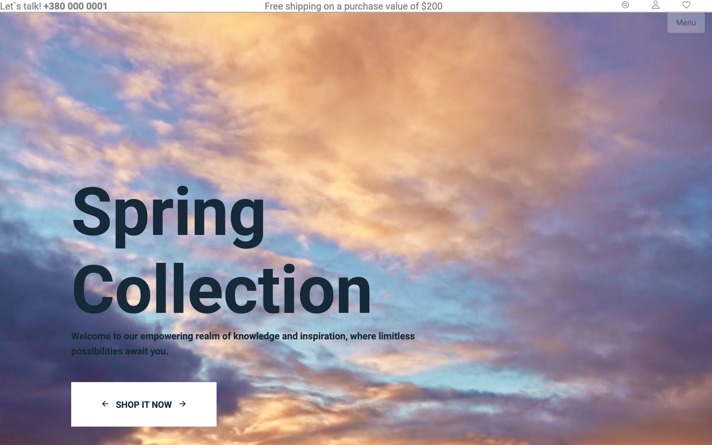
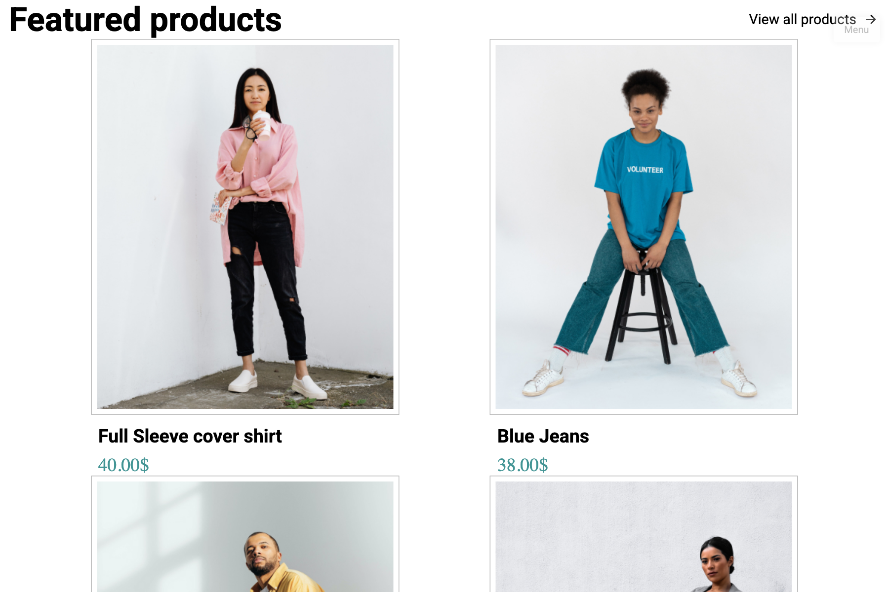
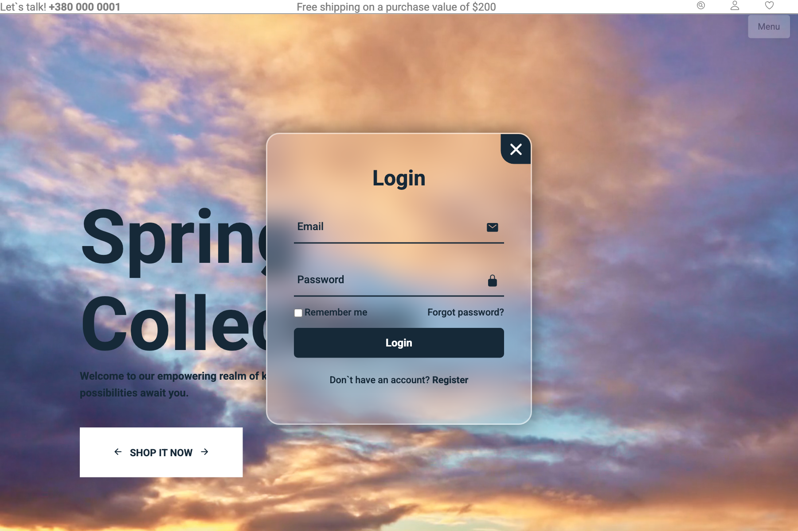
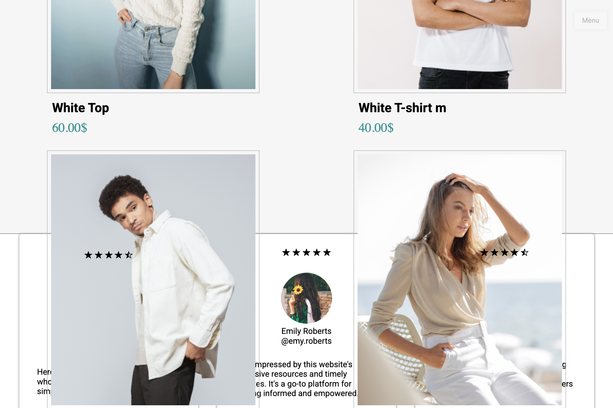

# Vibewave — Fashion E-Commerce Landing Page

Адаптивний веб-лендінг інтернет-магазину брендового одягу та аксесуарів. Проєкт реалізовано на чистому стеку веб-технологій (HTML5 / CSS3 / Vanilla JS) в рамках університетського курсу з веб-розробки.

[](https://developer.mozilla.org/en-US/docs/Web/HTML)
[](https://developer.mozilla.org/en-US/docs/Web/CSS)
[](https://developer.mozilla.org/en-US/docs/Web/JavaScript)
[](https://magshproget.github.io/Vibewave.github.io/)

**Live Demo:** [https://magshproget.github.io/Vibewave.github.io/](https://magshproget.github.io/Vibewave.github.io/)

---

## Огляд інтерфейсу та прив'язка до компонентів

### 1. Головний екран та навігація
**Файли:** `css/header-style.css`, `css/menu.css`, `index.html#start`

<p align="center">
  
</p>

- Верхня панель сповіщень: інформація про доставку, гаряча лінія підтримки та швидкі посилання.
- Банер сезонної колекції (Spring Collection): акцентні промо-блоки із закликом до дії (CTA).
- Головне навігаційне меню з підтримкою переходу між розділами сайту.

---

### 2. Каталог товарів та інтерактивні картки
**Файли:** `css/main.css`, `index.html#featured-products`

<p align="center">
  
</p>

- Адаптивна сітка товарів (Flexbox/Grid), що динамічно підлаштовується під роздільну здатність дисплея.
- Hover-ефекти карток: плавна CSS-анімація появи кнопок додавання в кошик та швидкого перегляду (`.appearing-box-clothing`).
- Інформаційні блоки цінників, знижок та категорій одягу.

---

### 3. Анімоване модальне вікно авторизації
**Файли:** `css/login-register.css`, `js/transition.js`

<p align="center">
  
</p>

- Модальне вікно входу та реєстрації на базі чистого JavaScript (DOM manipulation) без сторонніх бібліотек.
- Плавна анімація перемикання станів Login та Register через CSS-транзиції (`.wrapper.active`).
- Інтерактивні поля вводу, валідація, чекбокс збереження сесії та форма відновлення пароля.

---

### 4. Промо-секції, Flash Sales та відгуки
**Файли:** `css/footer.css`, `css/media.css`, `index.html#flash-sales`

<p align="center">
  
</p>

- Блоки лімітованих акційних пропозицій та таймерів гарячих знижок.
- Картка клієнтських відгуків (Testimonials) із фотографіями та оцінками покупців.
- Підвал сайту: форма підписки на новини, платіжні системи (Visa, MasterCard, American Express) та соціальні мережі.

---

## Стек технологій

| Компонент | Використані інструменти |
|---|---|
| **Розмітка** | Семантичний HTML5 |
| **Стилізація** | Модульний CSS3 (Flexbox, CSS Grid, Transitions, Media Queries) |
| **Скрипти** | Vanilla JavaScript (DOM API, Event Listeners) |
| **Іконки та шрифти** | Ionicons, Google Fonts (Roboto) |
| **Хостинг** | GitHub Pages |

---

## Структура проєкту

```text
Vibewave.github.io/
├── assets/                # Скріншоти та графіка для документації
│   ├── hero-section.png
│   ├── catalog-products.png
│   ├── auth-modal.png
│   └── promotions-reviews.png
├── css/
│   ├── main.css           # Основні стилі сіток, секцій каталогу та банерів
│   ├── header-style.css   # Стилі верхньої панелі та навігації
│   ├── menu.css           # Стилізація бічного та мобільного меню
│   ├── login-register.css # Стилі та анімації модального вікна авторизації
│   ├── media.css          # Адаптивні медіа-запити під різні екрани
│   └── footer.css         # Стилізація підвалу та контактної інформації
├── js/
│   └── transition.js      # Логіка відкриття/закриття модалок та бургер-меню
├── img/                   # Зображення товарів, банери, логотипи та іконки
├── index.html             # Головна сторінка сайту
└── README.md
```

---

## Локальний запуск

Сторонні залежності чи збирачі не потрібні:

1. Клонувати репозиторій:
   ```bash
   git clone https://github.com/Magshproget/Vibewave.github.io.git
   cd Vibewave.github.io
   ```

2. Відкрити файл `index.html` у браузері:
   ```bash
   open index.html
   ```
