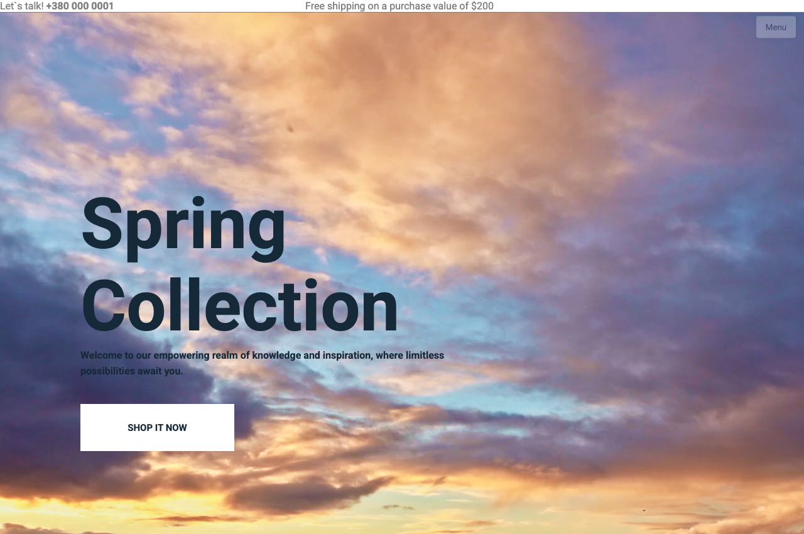

# Vibewave — Fashion E-Commerce Landing Page

Адаптивний веб-лендінг інтернет-магазину брендового одягу та аксесуарів. Проєкт реалізовано на чистому стеку веб-технологій (HTML5 / CSS3 / Vanilla JS) в рамках університетського курсу з веб-розробки.

[](https://developer.mozilla.org/en-US/docs/Web/HTML)
[](https://developer.mozilla.org/en-US/docs/Web/CSS)
[](https://developer.mozilla.org/en-US/docs/Web/JavaScript)
[](https://magshproget.github.io/Vibewave.github.io/)

**Live Demo:** [https://magshproget.github.io/Vibewave.github.io/](https://magshproget.github.io/Vibewave.github.io/)

<p align="center">
  
</p>

---

## Основні блоки та функціонал

- **Головний екран (Hero Section)**:
  - Презентація сезонних пропозицій (Spring Collection).
  - Акцентний заклик до дії (CTA) та навігація по колекціях.
- **Каталог товарів (Featured Products & Best Sales)**:
  - Адаптивна сітка карток одягу та аксесуарів (Flexbox/Grid).
  - Hover-ефекти: динамічна поява кнопок додавання в кошик та швидкого перегляду.
  - Категорії знижок, ціни та візуальне маркування.
- **Flash Sales & Promo**:
  - Блоки лімітованих акційних пропозицій та банери сезонного розпродажу.
- **Інтерактивні модальні форми (Auth Modal)**:
  - Спливаюче вікно входу та реєстрації на базі Vanilla JavaScript.
  - Плавна анімація перемикання між режимами Login та Register без перезавантаження сторінки.
  - Валідація полів та інтерактивні елементи керування (пароль, «Запам'ятати мене»).
- **Мобільна адаптивність**:
  - Повноцінне мобільне меню (Hamburger / Side drawer) для компактних екранів.
  - Медіа-запити (`media.css`) для коректного відображення на смартфонах, планшетах і десктопах.
- **Відгуки та футер**:
  - Секція відгуків клієнтів (Testimonials).
  - Інформація про доставку, платіжні системи та соціальні мережі.

---

## Стек технологій

| Компонент | Використані інструменти |
|---|---|
| **Розмітка** | Семантичний HTML5 |
| **Стилізація** | Модульний CSS3 (Flexbox, CSS Grid, Transitions, Media Queries) |
| **Скрипти** | Vanilla JavaScript (DOM API, Event Listeners) |
| **Іконки та шрифти** | Ionicons, Google Fonts (Roboto) |
| **Хостинг** | GitHub Pages |

---

## Структура проєкту

```text
Vibewave.github.io/
├── css/
│   ├── main.css           # Основні стилі сіток, секцій каталогу та банерів
│   ├── header-style.css   # Стилі верхньої панелі та навігації
│   ├── menu.css           # Стилізація бічного та мобільного меню
│   ├── login-register.css # Стилі та анімації модального вікна авторизації
│   ├── media.css          # Адаптивні медіа-запити під різні екрани
│   └── footer.css         # Стилізація підвалу та контактної інформації
├── js/
│   └── transition.js      # Логіка відкриття/закриття модалок та бургер-меню
├── img/                   # Зображення товарів, банери, логотипи та іконки
├── index.html             # Головна сторінка сайту
└── README.md
```

---

## Локальний запуск

Сторонні залежності чи збирачі не потрібні:

1. Клонувати репозиторій:
   ```bash
   git clone https://github.com/Magshproget/Vibewave.github.io.git
   cd Vibewave.github.io
   ```

2. Відкрити файл `index.html` у браузері:
   ```bash
   open index.html
   ```
